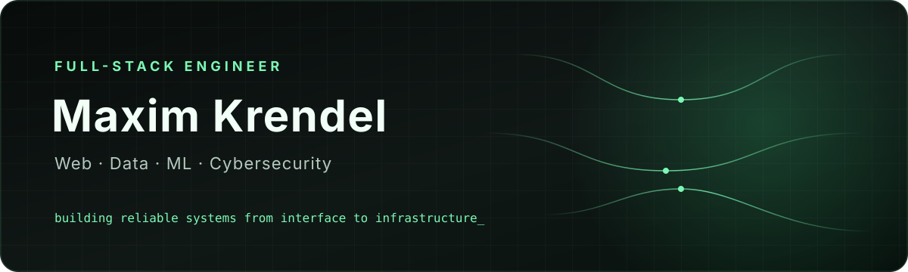

  

 

  
  
  

## I build systems that turn noisy data into useful decisions.

Full-stack engineer with **4+ years of production experience** across cybersecurity, data-intensive products, FinTech, and Web3. I work end to end—from React interfaces and Node.js APIs to Python pipelines, PostgreSQL data models, cloud infrastructure, and ML-assisted features.

Currently completing a **B.Sc. in Information Systems Engineering at Ben-Gurion University** while looking for a team where I can own meaningful product and engineering problems.

<table>
  <tr>
    <td align="center"><strong>~1M</strong> events processed daily</td>
    <td align="center"><strong>40+</strong> enterprise data sources</td>
    <td align="center"><strong>3×</strong> faster product responses</td>
    <td align="center"><strong>4+</strong> years in production</td>
  </tr>
</table>

## Selected work

### Reveal Security · Full-Stack Engineer — Data, ML & Cybersecurity

Designed multi-tenant ingestion and correlation pipelines that normalized roughly **one million daily events** from **40+ enterprise sources** into thousands of user journeys. Built ML-assisted risk scoring with embeddings, nearest-neighbor methods, tenant-aware statistics, and event-level explainability.

`Python` `Node.js` `TypeScript` `Vue` `PostgreSQL` `Docker` `AWS` `ML`

### [PEP / Fitev](https://github.com/krdmx/Fitev) · Local-first career workspace

A full-stack workspace for CV generation, vacancy and company research, application tracking, workflow automation, and PDF export. Built as a modular monorepo with a Next.js frontend, NestJS API, Prisma/PostgreSQL, n8n, Gotenberg, Caddy, and Docker Compose.

`Next.js` `NestJS` `TypeScript` `Prisma` `PostgreSQL` `n8n` `Docker`

### Rimonim · Google-supported university project

Led a four-person team building a digital product with Israel's Ministry of Aliyah and Integration. Coordinated delivery across product and engineering and helped improve user engagement by **21%**.

## Toolbox

**Product engineering**  
`TypeScript` `JavaScript` `Python` `Node.js` `React` `Next.js` `Vue` `NestJS`

**Data, ML & infrastructure**  
`PostgreSQL` `GraphQL` `REST` `WebSockets` `Docker` `AWS` `CI/CD` `Embeddings` `KNN`

**AI-native workflow**  
Daily work with **Claude Code**, **OpenAI Codex**, and task-specific agents for research, implementation, review, testing, and automation—with human ownership of architecture and final decisions.

## Earlier experience

**PRODCREATORS LABS · Full-Stack Engineer** — Delivered production React and Next.js systems for B2B, FinTech, and Web3 products; contributed to a performance program that reduced average response time from approximately **3s to 1s**.

**DigitalSkills'22 · 1st place** — Winner among 15 competing teams.

---

  Open to full-stack and software engineering opportunities in Israel.

